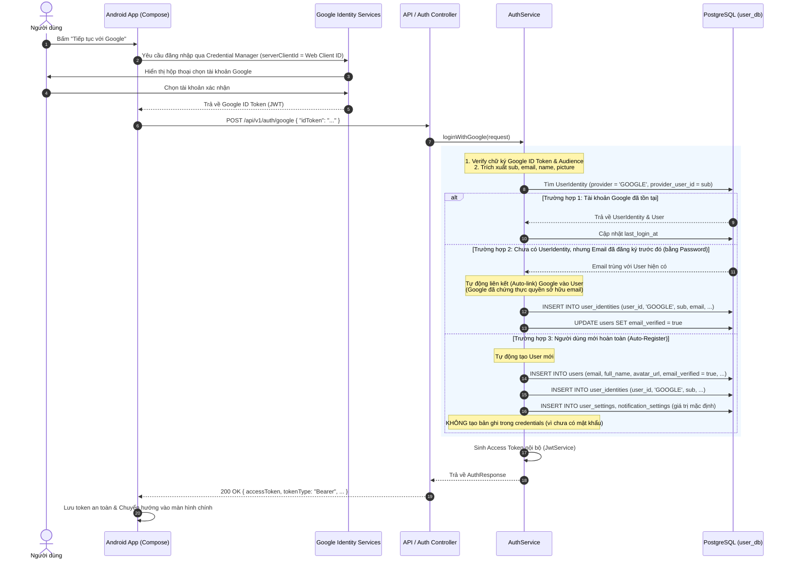

# Kế hoạch Triển khai: Đăng ký & Đăng nhập bằng Google cho Mobile App

> **Endpoint:** `POST /api/v1/auth/google`  
> **Áp dụng cho:** Android App (**Kotlin + Jetpack Compose**) & Backend (**Spring Boot 4 / Java 17 Microservice**).

---

## 0. Implementation Rules

Before making any changes:

1. Inspect the existing project structure.
2. Inspect existing:
   - AuthController
   - AuthService
   - SecurityConfig
   - User entity
   - UserRepository
   - UserSettings
   - NotificationSettings
   - AuthResponse
   - JWT/JwtService
   - database migration V1__init_schema.sql
   - API Gateway routing
   - Android AuthViewModel
   - Retrofit configuration
   - existing authentication flow

3. Reuse existing architecture and conventions.
4. Do NOT create duplicate classes/services if an equivalent already exists.
5. Do NOT change unrelated authentication behavior.
6. Do NOT modify database schema unless absolutely necessary.
7. If the existing implementation conflicts with this plan, explain the conflict before choosing a solution.

## 1. Tổng quan & Luồng xác thực (Authentication Flow)

### 1.1. Nguyên tắc bảo mật
* **Tuyệt đối không gửi email thô từ Client:** Mobile app không được gửi email hoặc tên người dùng trực tiếp lên backend để tạo phiên đăng nhập vì dễ bị giả mạo.
* **Cơ chế Google ID Token (JWT):**
  1. Người dùng chọn tài khoản Google trên điện thoại qua Google Credential Manager.
  2. Google Play Services trả về một **Google ID Token (JWT)** đã được Google ký số bảo mật.
  3. Mobile App gửi ID Token này lên Backend qua endpoint: `POST /api/v1/auth/google`.
  4. Backend xác thực chữ ký (Signature), kiểm tra hạn dùng (`exp`) và đối chiếu Audience (`aud` phải khớp với Web Client ID của hệ thống).
  5. Sau khi hợp lệ, Backend trích xuất:
     - `sub` (Google User ID cố định vĩnh viễn)
     - `email`
     - `name` (họ tên)
     - `picture` (ảnh đại diện)
  6. Backend sinh và trả về **Access Token nội bộ của hệ thống** (`accessToken` JWT) trong `AuthResponse`.

---

### 1.2. Sơ đồ tuần tự (Sequence Diagram)



---

## 2. Chuẩn bị trên Google Cloud Console

Cần tạo **2 Client IDs** trong cùng 1 dự án trên [Google Cloud Console](https://console.cloud.google.com/):

| STT | Loại Client ID | Sử dụng tại | Cấu hình quan trọng |
| :--- | :--- | :--- | :--- |
| **1** | **Web Application** | Backend & Android | - Backend dùng để verify `aud` trong ID Token.<br/>- Android dùng làm `serverClientId` khi xin token. |
| **2** | **Android Application** | Mobile App | - **Package name:** `com.quan.finance_app`<br/>- **SHA-1 Fingerprint:** Lấy từ Keystore debug/release của Android app. |

> **Lệnh lấy mã SHA-1 trên Windows PowerShell:**
> ```powershell
> keytool -list -v -keystore $env:USERPROFILE\.android\debug.keystore -alias androiddebugkey -storepass android -keypass android
> ```

---

## 3. Đặc tả API Backend (`POST /api/v1/auth/google`)

### Request
* **URL:** `POST /api/v1/auth/google`
* **Headers:** `Content-Type: application/json`
* **Body:**
```json
{
  "idToken": "eyJhbGciOiJSUzI1NiIsImtpZCI6Ij..."
}
```

### Response Thành công (HTTP 200 OK)
```json
{
  "accessToken": "eyJhbGciOiJIUzI1NiIsInR5cCI6IkpXVCJ9...",
  "tokenType": "Bearer",
  "expiresIn": 86400,
  "userId": "3fa85f64-5717-4562-b3fc-2c963f66afa6",
  "email": "user@gmail.com",
  "fullName": "Nguyễn Văn A"
}
```

### Response Lỗi
* **HTTP 401 Unauthorized:** ID Token không hợp lệ, hết hạn, hoặc sai Audience.
* **HTTP 403 Forbidden:** Tài khoản đã bị khóa hoặc vô hiệu hóa (`status != ACTIVE`).
* **HTTP 400 Bad Request:** Thiếu trường `idToken`.

---

## 4. Kế hoạch triển khai Backend (`user-service`)

### 4.1. Thêm Dependency
Thư viện Google API Client chính thức để parse và verify ID Token:
* **File:** `backend/user-service/build.gradle`
```groovy
dependencies {
    // Google OAuth / ID Token Verifier
    implementation 'com.google.api-client:google-api-client:2.7.0'
}
```

### 4.2. Cấu hình biến môi trường
* **File:** `backend/user-service/src/main/resources/application.properties`
```properties
# Google OAuth 2.0
google.client-id=${GOOGLE_CLIENT_ID:your-web-client-id.apps.googleusercontent.com}
```

### 4.3. Tạo Entity `UserIdentity` & Repository
Bảng `user_identities` đã có sẵn trong database migration (`V1__init_schema.sql`). Tạo class Entity tương ứng:
* **File:** `com.quan.userservice.identity.UserIdentity.java`
```java
package com.quan.userservice.identity;

import com.quan.userservice.user.User;
import jakarta.persistence.*;
import lombok.Getter;
import lombok.NoArgsConstructor;
import lombok.Setter;
import org.hibernate.annotations.CreationTimestamp;
import org.hibernate.annotations.UpdateTimestamp;

import java.time.Instant;
import java.util.UUID;

@Entity
@Table(name = "user_identities")
@Getter
@Setter
@NoArgsConstructor
public class UserIdentity {
    @Id
    @GeneratedValue(strategy = GenerationType.UUID)
    private UUID id;

    @ManyToOne(fetch = FetchType.LAZY, optional = false)
    @JoinColumn(name = "user_id", nullable = false)
    private User user;

    @Column(nullable = false, length = 20)
    private String provider = "GOOGLE";

    @Column(name = "provider_user_id", nullable = false)
    private String providerUserId; // Claim 'sub' của Google

    @Column(name = "email")
    private String email;

    @Column(name = "email_verified", nullable = false)
    private boolean emailVerified = true;

    @Column(name = "display_name", length = 100)
    private String displayName;

    @Column(name = "avatar_url")
    private String avatarUrl;

    @Column(name = "linked_at", nullable = false)
    private Instant linkedAt = Instant.now();

    @Column(name = "last_login_at")
    private Instant lastLoginAt;

    @CreationTimestamp
    @Column(name = "created_at", nullable = false, updatable = false)
    private Instant createdAt;

    @UpdateTimestamp
    @Column(name = "updated_at", nullable = false)
    private Instant updatedAt;
}
```

* **File:** `com.quan.userservice.identity.UserIdentityRepository.java`
```java
package com.quan.userservice.identity;

import org.springframework.data.jpa.repository.JpaRepository;
import java.util.Optional;
import java.util.UUID;

public interface UserIdentityRepository extends JpaRepository<UserIdentity, UUID> {
    Optional<UserIdentity> findByProviderAndProviderUserId(String provider, String providerUserId);
    boolean existsByUserIdAndProvider(UUID userId, String provider);
}
```

### 4.4. DTO Request
* **File:** `com.quan.userservice.auth.dto.GoogleLoginRequest.java`
```java
package com.quan.userservice.auth.dto;

import jakarta.validation.constraints.NotBlank;

public record GoogleLoginRequest(
    @NotBlank(message = "Google ID Token không được để trống")
    String idToken
) {}
```

### 4.5. Service xác thực Google Token
* **File:** `com.quan.userservice.auth.GoogleTokenVerifierService.java`
```java
package com.quan.userservice.auth;

import com.google.api.client.googleapis.auth.oauth2.GoogleIdToken;
import com.google.api.client.googleapis.auth.oauth2.GoogleIdTokenVerifier;
import com.google.api.client.http.javanet.NetHttpTransport;
import com.google.api.client.json.gson.GsonFactory;
import com.quan.userservice.auth.exception.InvalidCredentialsException;
import org.springframework.beans.factory.annotation.Value;
import org.springframework.stereotype.Service;

import java.util.Collections;

@Service
public class GoogleTokenVerifierService {

    private final GoogleIdTokenVerifier verifier;

    public GoogleTokenVerifierService(@Value("${google.client-id}") String clientId) {
        this.verifier = new GoogleIdTokenVerifier.Builder(new NetHttpTransport(), new GsonFactory())
                .setAudience(Collections.singletonList(clientId))
                .build();
    }

    public GoogleIdToken.Payload verify(String idTokenString) {
        try {
            GoogleIdToken idToken = verifier.verify(idTokenString);
            if (idToken == null) {
                throw new InvalidCredentialsException();
            }
            return idToken.getPayload();
        } catch (Exception e) {
            throw new InvalidCredentialsException();
        }
    }
}
```

### 4.6. Cập nhật `AuthService.java`
Thêm hàm `loginWithGoogle`:
```java
@Transactional
public AuthResponse loginWithGoogle(GoogleLoginRequest request) {
    GoogleIdToken.Payload payload = googleTokenVerifierService.verify(request.idToken());

    String googleSub = payload.getSubject();
    String email = payload.getEmail().trim().toLowerCase(Locale.ROOT);
    String fullName = (String) payload.get("name");
    String avatarUrl = (String) payload.get("picture");

    // 1. Kiểm tra đã có Google Identity chưa
    UserIdentity identity = userIdentityRepository
            .findByProviderAndProviderUserId("GOOGLE", googleSub)
            .orElse(null);

    User user;
    if (identity != null) {
        user = identity.getUser();
        identity.setLastLoginAt(Instant.now());
    } else {
        // 2. Chưa có identity -> Kiểm tra User theo email
        user = userRepository.findByEmailAndDeletedAtIsNull(email).orElse(null);
        if (user == null) {
            // 3. User mới hoàn toàn -> Đăng ký tự động
            user = new User();
            user.setEmail(email);
            user.setFullName(fullName != null ? fullName : "User");
            user.setAvatarUrl(avatarUrl);
            user.setEmailVerified(true);
            user.setEmailVerifiedAt(Instant.now());
            userRepository.save(user);

            userSettingsRepository.save(new UserSettings(user));
            notificationSettingsRepository.save(new NotificationSettings(user));
        } else {
            // User cũ -> Link tài khoản Google
            if (!user.isEmailVerified()) {
                user.setEmailVerified(true);
                user.setEmailVerifiedAt(Instant.now());
            }
        }

        // Tạo bản ghi UserIdentity
        UserIdentity newIdentity = new UserIdentity();
        newIdentity.setUser(user);
        newIdentity.setProvider("GOOGLE");
        newIdentity.setProviderUserId(googleSub);
        newIdentity.setEmail(email);
        newIdentity.setDisplayName(fullName);
        newIdentity.setAvatarUrl(avatarUrl);
        newIdentity.setLastLoginAt(Instant.now());
        userIdentityRepository.save(newIdentity);
    }

    if (user.getStatus() != UserStatus.ACTIVE) {
        throw new AccountDisabledException();
    }

    user.setLastLoginAt(Instant.now());
    return buildAuthResponse(user);
}
```

### 4.7. Endpoint trong `AuthController.java` & SecurityConfig
* Cập nhật `AuthController.java` hỗ trợ cả `/api/v1/auth` và endpoint `/google`:
```java
@RestController
@RequestMapping({"/api/v1/auth", "/api/auth"})
@RequiredArgsConstructor
public class AuthController {
    // ...
    @PostMapping("/google")
    public AuthResponse loginWithGoogle(@Valid @RequestBody GoogleLoginRequest request) {
        return authService.loginWithGoogle(request);
    }
}
```
* `SecurityConfig.java`: Cấu hình mở quyền truy cập:
```java
.requestMatchers("/api/auth/**", "/api/v1/auth/**").permitAll()
```

---

## 5. Kế hoạch triển khai Android App (`Jetpack Compose`)

### 5.1. Thư viện Android
* **File:** `frontend/app/build.gradle.kts`
```kotlin
dependencies {
    // Credential Manager chính thức từ Google (hỗ trợ Android 14+ và tương thích ngược tới Android 7)
    implementation("androidx.credentials:credentials:1.3.0")
    implementation("androidx.credentials:credentials-play-services-auth:1.3.0")
    implementation("com.google.android.libraries.identity.googleid:googleid:1.1.1")
}
```

### 5.2. Hàm gọi Google Sign-In trong ViewModel
```kotlin
fun onGoogleSignInClicked(context: Context) {
    val credentialManager = CredentialManager.create(context)
    val googleIdOption = GetGoogleIdOption.Builder()
        .setFilterByAuthorizedAccounts(false)
        .setServerClientId(SERVER_WEB_CLIENT_ID) // Client ID loại Web từ Google Cloud Console
        .setAutoSelectEnabled(false)
        .build()

    val request = GetCredentialRequest.Builder()
        .addCredentialOption(googleIdOption)
        .build()

    viewModelScope.launch {
        try {
            val response = credentialManager.getCredential(context = context, request = request)
            val credential = response.credential
            if (credential is CustomCredential && credential.type == GoogleIdTokenCredential.TYPE_GOOGLE_ID_TOKEN_CREDENTIAL) {
                val googleIdTokenCredential = GoogleIdTokenCredential.createFrom(credential.data)
                val idToken = googleIdTokenCredential.idToken
                // Gửi idToken lên Backend
                sendGoogleTokenToBackend(idToken)
            }
        } catch (e: GetCredentialException) {
            // Xử lý khi user bấm hủy hoặc lỗi kết nối
            _uiState.update { it.copy(errorMessage = e.message) }
        }
    }
}
```

### 5.3. Retrofit Service
```kotlin
interface AuthApiService {
    @POST("api/v1/auth/google")
    suspend fun loginWithGoogle(@Body request: GoogleLoginRequest): Response<AuthResponse>
}
```

### 5.4. Giao diện Compose (Nút Google Button)
* Thêm nút đăng nhập bằng Google chuẩn giao diện Material 3:
```kotlin
OutlinedButton(
    onClick = { onGoogleSignInClicked(context) },
    modifier = Modifier.fillMaxWidth().height(50.dp),
    shape = RoundedCornerShape(12.dp)
) {
    Icon(
        painter = painterResource(id = R.drawable.ic_google),
        contentDescription = "Google",
        modifier = Modifier.size(24.dp),
        tint = Color.Unspecified
    )
    Spacer(modifier = Modifier.width(12.dp))
    Text(text = "Tiếp tục với Google")
}
```

---

## 6. Danh sách công việc triển khai (Checklist)

- [ ] **Bước 1: Google Cloud Console**
  - [ ] Tạo Web Client ID & Android Client ID.
  - [ ] Lấy SHA-1 debug keystore thêm vào Android Client ID.
  - [ ] Lưu Web Client ID vào biến môi trường Backend & Mobile.
- [ ] **Bước 2: Backend `user-service`**
  - [ ] Thêm dependency `google-api-client` vào `build.gradle`.
  - [ ] Tạo `UserIdentity.java` & `UserIdentityRepository.java`.
  - [ ] Tạo `GoogleLoginRequest.java`.
  - [ ] Tạo `GoogleTokenVerifierService.java`.
  - [ ] Thêm logic `loginWithGoogle` vào `AuthService.java`.
  - [ ] Expose endpoint `POST /api/v1/auth/google` trong `AuthController.java`.
  - [ ] Cập nhật `SecurityConfig.java` cho phép `/api/v1/auth/**`.
  - [ ] Build và kiểm thử compile với `.\gradlew.bat compileJava`.
- [ ] **Bước 3: Android Client**
  - [ ] Thêm Credential Manager vào `app/build.gradle.kts`.
  - [ ] Viết hàm gọi Google Sign-In trong `AuthViewModel`.
  - [ ] Gắn API Retrofit gọi endpoint `POST /api/v1/auth/google`.
  - [ ] Hiển thị nút "Tiếp tục với Google" trên `LoginScreen` & `RegisterScreen`.
  - [ ] Test trực tiếp trên Android Emulator / Thiết bị thật.

## 7. Acceptance Criteria

The implementation is considered complete only when all conditions below are satisfied.

### Backend

- [ ] `POST /api/v1/auth/google` accepts a Google ID Token.
- [ ] Invalid token returns HTTP 401.
- [ ] Expired token returns HTTP 401.
- [ ] Wrong audience returns HTTP 401.
- [ ] Invalid issuer returns HTTP 401.
- [ ] `email_verified != true` cannot be used for account linking.
- [ ] Existing Google identity logs the existing user in.
- [ ] Existing password account with verified Google email is linked.
- [ ] New Google user is automatically created.
- [ ] Disabled user cannot log in.
- [ ] Google `sub` is stored as `provider_user_id`.
- [ ] Internal JWT is generated after successful authentication.
- [ ] Existing password login continues to work.
- [ ] Existing authentication endpoints are not broken.

### Android

- [ ] Google account picker opens successfully.
- [ ] Google ID Token is obtained.
- [ ] Token is sent to `/api/v1/auth/google`.
- [ ] Internal access token is stored using the existing secure token storage.
- [ ] Successful login navigates to the existing authenticated screen.
- [ ] User cancellation does not crash the app.
- [ ] Backend 401/403/400 errors are displayed through the existing UI state mechanism.

### Testing

- [ ] New Google account
- [ ] Existing Google account
- [ ] Existing password account
- [ ] Invalid ID token
- [ ] Expired ID token
- [ ] Wrong audience
- [ ] Disabled account
- [ ] User cancels Google login
- [ ] Network error